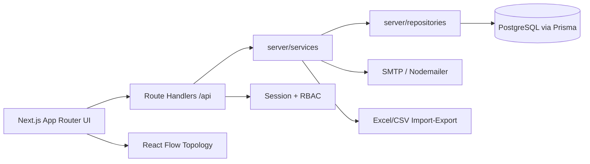

# Fiber Inventory Management Portal

Production-style telecom operations portal for site reference data, ODF/rack-aware fiber inventory, service tracing, import review, utilization alerts, and role-based administration.

## Elevator pitch
Give network planners and NOC teams one system of record for fiber connectivity — from site master data and ODF ports through service trace, impact analysis, and operational alerts.

## Architecture



| Layer | Responsibility |
|---|---|
| `app/` | Portal pages + REST route handlers |
| `components/` | Dashboard, inventory, ODF, import, admin UI |
| `lib/` | Auth, validation, telecom helpers, regions, secrets |
| `server/services/` | Business logic (trace, impact, alerts, imports) |
| `server/repositories/` | Prisma data access |
| `prisma/` | Schema, migrations, seed |

## Tech stack
- **Next.js 15 + React 19 + TypeScript** — typed full-stack app with App Router
- **Prisma + PostgreSQL** — normalized telecom data model (SQLite only for early local experiments)
- **Tailwind CSS** — consistent operational UI
- **React Flow** — site topology visualization
- **Zod / ExcelJS / xlsx / Nodemailer** — validation, workbook I/O, SMTP notifications

## Features
- Auth: login, remember-me session, forgot password, temporary passwords, forced password change
- Sites & regions (prefix-derived), criticality tags, attachments
- Fiber inventory: segments, ODF/rack/port context, reserve/release, bulk operations
- Service trace with hop-by-hop ODF/port visibility + emailable reports
- CSV/XLSX import staging with duplicate detection and approval workflow
- Splitter inventory import and maintenance
- Dashboard metrics, impact analysis, configurable alert policies
- Admin: users/roles, SMTP templates, import rules, audit logging

## Local setup

### Prerequisites
- Node.js 18+
- PostgreSQL 17/18
- npm

### Install
```bash
git clone https://github.com/AbdulHakeem007/Fiber.git
cd Fiber
npm install
cp .env.example .env
```

### Environment variables
| Variable | Purpose |
|---|---|
| `DATABASE_URL` | PostgreSQL connection string |
| `APP_NAME` | Display name |
| `AUTH_SECRET` | HMAC secret for session cookies |
| `SECRETS_ENCRYPTION_KEY` | Encrypts SMTP credentials at rest |
| `FEATURE_DEMO_DATA` | Optional demo seeding flag |
| `ATTACHMENT_STORAGE_ROOT` | Optional upload root |
| `NEXT_PUBLIC_SITE_STENCIL_DIR` | Topology stencil asset path |

See `.env.example` for the canonical template.

### Database
Option A — restore seeded dump (fastest demo):
```bash
createdb -U postgres fiber_inventory
pg_restore -U postgres -d fiber_inventory --clean --if-exists fiber_inventory_seeded.dump
npm run dev
```

Option B — empty schema + seed:
```bash
npx prisma migrate deploy
npm run seed
npm run dev
```

Open http://localhost:3000

Seeded local users (dump/seed dependent):
- Admin: `admin@fiber-portal.local` / `admin123`
- Planner: `planner@fiber-portal.local` / `planner123`
- Viewer: `viewer@fiber-portal.local` / `viewer123`

## Key API surface
Authenticated JSON route handlers under `app/api/` including:
- `POST /api/auth/login` · `POST /api/auth/logout` · password reset routes
- `GET/POST /api/sites` · site detail & inventory aggregations
- `GET/PATCH /api/segments/*` · fiber capacity, split, export
- `POST /api/service-trace` · path exploration & report email
- `POST /api/import/upload` · staging, validate, approve/commit
- `GET /api/dashboard/stats` · `POST /api/impact` · alerts admin APIs

Treat these as internal application APIs; auth session required except public auth routes.

## Scripts
| Command | Description |
|---|---|
| `npm run dev` | Development server |
| `npm run build` | Production build |
| `npm run typecheck` | TypeScript project check |
| `npm run seed` | Seed local data |

## License
MIT — see [LICENSE](./LICENSE).
